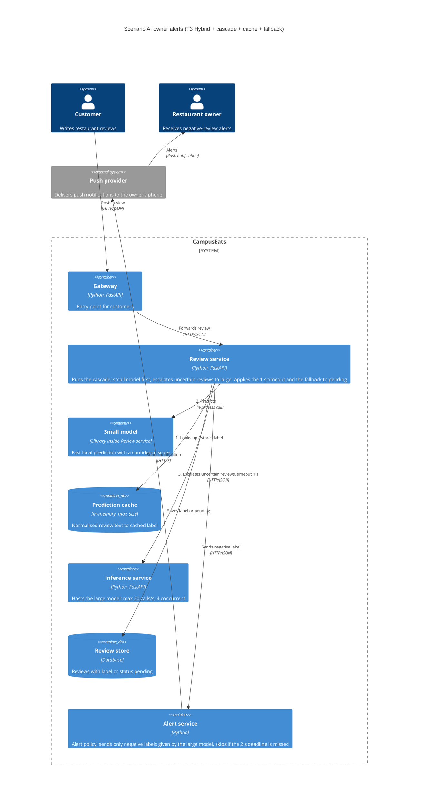

# Task 4: Deployment topologies and trade-offs

**Name / ชื่อ:** สุทธนพ ชะนะ

**Student ID / รหัสนิสิต:** 6632239821

This is **individual work**: each student completes and submits their own copy, in their own fork.

*งานนี้เป็น**งานเดี่ยว** นิสิตแต่ละคนทำและส่งงานของตัวเอง ใน fork ของตัวเอง*

**Scenario (A, B or C) / Scenario ที่เลือก:** A

Choose **one** scenario below. If the last digit of your student ID is odd, take A or B; if it is even, take B or C. Use your measurements from Tutorial 6 as evidence: cite run names from `results/runs.csv`. Answer in Thai or English.

เลือก scenario **หนึ่ง** ข้อด้านล่าง ถ้าเลขตัวสุดท้ายของรหัสนิสิตเป็นเลขคี่ ให้เลือก A หรือ B ถ้าเป็นเลขคู่ ให้เลือก B หรือ C ใช้ผลการวัดจาก tutorial ที่ทำไปเป็นข้อมูลอ้างอิง โดยอ้างชื่อ run จาก `results/runs.csv` จะตอบเป็นภาษาไทยหรือภาษาอังกฤษก็ได้

Facts that hold in every scenario / ข้อเท็จจริงที่ใช้กับทุก scenario:

- The large model serves at most **20 calls per second** (4 calls at once × about 200 ms each), and every call costs money.

  *large model รับได้สูงสุด **20 calls ต่อวินาที** (พร้อมกัน 4 calls × ประมาณ 200 ms ต่อ call) และทุก call มีค่าใช้จ่าย*
- The small model is fast and cheap enough to run anywhere, including inside the review service or on a kiosk, but it is much less accurate on its own.

  *small model เร็วและถูกพอที่จะรันที่ไหนก็ได้ รวมถึงภายใน review service หรือบน kiosk แต่ถ้าใช้ตัวเดียวจะแม่นน้อยกว่ามาก*

## Scenarios

**A. Owner alerts.** When a customer posts a negative review, the restaurant owner gets a push notification within **2 seconds**. At the lunch peak, CampusEats receives **40 reviews per second**. A missed alert is acceptable, but a wrong alert (for example, "your customer is unhappy" when they are happy) makes owners stop trusting alerts and, in the end, ignore them.

*เมื่อลูกค้าโพสต์รีวิวเชิงลบ เจ้าของร้านจะต้องได้รับ push notification ภายใน **2 วินาที** เวลาช่วงพีคตอนเที่ยง CampusEats ได้รับรีวิวจำนวน **40 รายการต่อวินาที** การพลาด alert ไปบ้างนั้นยอมรับได้ แต่ alert ที่ผิด (เช่น "ลูกค้าไม่พอใจ" ทั้งที่จริงๆ แล้วพอใจ) จะทำให้เจ้าของร้านไม่เชื่อถือและเลิกสนใจ alert ในที่สุด*

**B. Canteen kiosk.** A tablet in each canteen lets students leave a review on the spot. However, the canteen Wi-Fi is poor: the tablets lose their connection several times a day, for minutes at a time. The system must accept every review, even while a tablet is offline. Restaurant owners need the labels **by the end of the day**.

*มี tablet ในแต่ละโรงอาหารให้นิสิตรีวิวได้ทันที อย่างไรก็ดี การเชื่อมต่อ Wi-Fi ในโรงอาหารไม่ดี ทำให้ tablet หลุดการเชื่อมต่อวันละหลายครั้ง ครั้งละหลายนาที ระบบจะต้องรับรีวิวได้ทุกรายการแม้ขณะที่กำลัง offline อยู่ และเจ้าของร้านต้องการ label **ภายในสิ้นวัน***

**C. Weekly report.** Restaurant owners want a weekly sentiment report. Nothing in producing this report has to be real-time. **Accuracy matters most** and **cost must be minimal**.

*เจ้าของร้านต้องการรายงาน sentiment รายสัปดาห์ ไม่มีอะไรที่จะต้องทำแบบ real-time ในการออกรายงานนี้ ความแม่นยำ **(accuracy) สำคัญที่สุด** และ **ค่าใช้จ่ายต้องน้อยที่สุด***

## Topologies and patterns to choose from / Topology และ pattern ที่เลือกใช้ได้

| | Topology | Where the model runs / โมเดลรันที่ไหน |
|---|---|---|
| T1 | Model as a service, synchronous | Inference service, called for each review (today's baseline) *inference service ถูกเรียกทุกรีวิว (baseline ของวันนี้)* |
| T2 | Model as a library | Inside the review service, or on the device *ภายใน review service หรือบนอุปกรณ์* |
| T3 | Hybrid | Small model locally, large model as a remote service *small model รันในเครื่อง large model เป็น remote service* |
| T4 | Asynchronous / batch | Reviews are queued (broker, W10) or stored, and scored later in bulk *รีวิวถูกเข้าคิว (broker, W10) หรือเก็บไว้ แล้วติด label ทีหลังเป็นชุด* |

Combine one topology with any of the patterns from Tutorial 6: **fallback**, **cascade** and **cache**.

*เลือก topology หนึ่งแบบ แล้วผสมกับ pattern จาก Tutorial 6 ได้ตามต้องการ: **fallback**, **cascade** และ **cache***

## 1. Quality requirements

The three most important quality requirements for your scenario, each with a number where possible.

*quality requirements ที่สำคัญที่สุด 3 ข้อของ scenario ที่เลือก ระบุตัวเลขเมื่อทำได้*

| # | Quality | Requirement |
|---|---|---|
| 1 | Latency| เจ้าของร้านได้รับ push notification ภายใน 2 วินาที หลังส่งรีวิว โดยกำหนด timeout ของการเรียก large ที่ 1 วินาที และจัดงบเวลาสำหรับขั้นตอนอื่นรวมการส่ง push|
| 2 | Throughput| รองรับ 40 reviews/s และเรียก large ไม่เกิน 20 calls/s โดยตั้งเป้าใช้งานไม่เกิน 16 calls/s เพื่อสำรอง capacity อย่างน้อย 20% |
| 3 | Precision | ตั้งเป้า precision ของ alert เชิงลบ ≥95% กล่าวคือ alert ที่ส่งผิดไม่เกิน 5% ของ alert ทั้งหมด หากไม่มั่นใจหรือ large timeout ให้สถานะ pending และไม่ส่ง alert|

## 2. Design / การออกแบบ

Your topology, the patterns you add, and a container-level diagram (C4 level 2). The C4 diagram must be written in Mermaid.

*topology ที่เลือก pattern ที่เพิ่ม และ diagram ระดับ container (C4 level 2) เขียนด้วย Mermaid*

**Topology:** T3 Hybrid. **Patterns:** cascade, cache, fallback.

## 3. Evidence / หลักฐาน

Which runs support your choice? Show the numbers and, for scenario A, the capacity arithmetic: how many large-model calls per second does your design need at the peak?

*run ไหนที่สนับสนุนการตัดสินใจของนิสิต ให้นิสิตแสดงตัวเลขประกอบ และสำหรับ scenario A ให้นิสิตแสดงการคำนวณ capacity ด้วย เพื่อแสดงว่าในช่วงพีคนั้น design ของนิสิตต้องใช้ large model กี่ calls ต่อวินาที*

| Run | What it shows / แสดงอะไร |
|---|---|
|t0-large | เป็น baseline แบบเรียก large ทุกรีวิว เมื่อรับ 40 reviews/s จึงต้องเรียก large 40 calls/s เกิน capacity 20 calls/s เป็น 2 เท่า|
| t2-0.7 | cascade threshold 0.7 อย่างเดียว เรียก large 53% -> 40 × 0.53 = 21.2 calls/s เกิน capacity 20 calls/s จึงต้องเพิ่ม cache |
| t3-cache | threshold 0.7 + cache: เรียก large 38%, cache hits 35%, p95 = 543 ms, accuracy 93.0% -> 40 × 0.38 = 15.2 calls/s อยู่ภายใน capacity และเหลือ headroom 24% |

## 4. ADR

Use the ADR format from W5.

*ใช้รูปแบบ ADR จาก W5*

**Title:** T3 Hybrid ร่วมกับ cascade, cache และ fallback

**Status:** Proposed

**Context:** 
CampusEats ต้องส่ง push notification ให้เจ้าของร้านภายใน 2 วินาที เมื่อพบรีวิวเชิงลบ ช่วงพีคมีรีวิว 40 รายการ/วินาที แต่ large model รองรับได้สูงสุด 20 calls/วินาที การเรียก large ทุกรีวิวจึงต้องการ capacity เป็นสองเท่าของที่มี

การแจ้งเตือนผิดทำให้เจ้าของร้านสูญเสียความเชื่อมั่น ขณะที่การพลาดแจ้งเตือนบางครั้งยอมรับได้ จึงให้ความสำคัญกับ precision ของ alert เชิงลบ และอนุญาตให้ระบบงดแจ้งเตือนเมื่อไม่มั่นใจ

จากตัวเลขของ t3-cache ที่ให้มา ระบบเรียก large 38% มี cache hits 35% และ latency p95 = 543 ms อย่างไรก็ตาม ยังไม่มีผลวัด precision ของ alert และยังต้องตรวจสอบ latency ตั้งแต่รับรีวิวจนเจ้าของร้านได้รับ push

**Decision:**
เลือก T3 Hybrid โดยรัน small model ภายใน Review service และเรียก large model ผ่าน remote inference service ร่วมกับรูปแบบดังนี้:

- Cascade: ใช้ threshold 0.7 ให้ small ประมวลผลก่อน และส่งกรณีที่ไม่มั่นใจไปยัง large (threshold 0.7 อย่างเดียวเรียก large 53% = 21.2 calls/s เกิน capacity จึงต้องใช้ร่วมกับ cache) โดยทดสอบเกณฑ์ส่ง alert แยกจาก threshold ที่ใช้ตัดสินใจเรียก large

- Cache: ใช้ผลเดิมที่ยังใช้ได้สำหรับรีวิวซ้ำ เพื่อลดจำนวน remote calls โดยใช้ t3-cache เป็นหลักฐานเริ่มต้นของการออกแบบ

- Fallback: กำหนด timeout ของ large ที่ 1 วินาที หาก timeout ไม่มี capacity หรือผลยังไม่มั่นใจ ให้บันทึกสถานะ pending และไม่ส่ง alert

- Alert policy: ส่ง alert เฉพาะผล negative ที่ **large model เป็นผู้ให้ label** (รวมผลที่ cache ไว้จาก large) ไม่ส่ง alert จากผล small อย่างเดียว เพราะ small อาจมั่นใจผิด เช่น รีวิวประชด ซึ่งจะเป็น alert ผิดที่ทำให้เจ้าของร้านเลิกเชื่อถือ การกำหนดนี้ไม่เพิ่มจำนวน call ไป large (ยังอยู่ที่ 15.2 calls/s) ตั้งเป้า precision ≥95% และส่งให้ถึงเจ้าของร้านภายใน 2 วินาที หากส่งไม่ทันให้ข้าม alert นั้น

ระบบต้องจำกัดการเรียก large ไม่เกิน 20 calls/วินาที และ 4 calls พร้อมกัน เพื่อรับมือกับการกระจุกตัวของคำขอ แม้ค่าเฉลี่ยที่คำนวณได้จะอยู่ภายใน capacity ส่วนคำขอที่เกิน limit จะไม่เข้าคิวรอ แต่ถูกบันทึกเป็น pending และไม่ส่ง alert (load shedding)

**Consequences:**
- Positive: รองรับ peak ตามสัดส่วนการเรียก large ที่วัดได้ และลดค่าใช้จ่ายของ large เมื่อเทียบกับการเรียกทุกรีวิว การงดแจ้งเตือนเมื่อไม่มั่นใจช่วยให้ระบบไม่ต้องเดาผลในกรณีบริการขัดข้อง

- Negative: ระบบซับซ้อนขึ้นจาก cascade, cache และการจัดการ timeout และอาจพลาด alert บางรายการ โดยเฉพาะรีวิวเชิงลบที่ small มั่นใจและจบที่ small จะไม่มี alert เพราะเรายอมแลกความครบถ้วนกับ precision ผลด้าน capacity ขึ้นอยู่กับลักษณะรีวิวและ cache hit rate จึงต้องติดตามเมื่อใช้งานจริง นอกจากนี้ accuracy รวมยังยืนยันเป้าหมาย precision ≥95% ไม่ได้ และ p95 543 ms ยังไม่รับประกัน deadline ของทุก alert

**Alternatives considered:** at least one topology you rejected, and why.

*อย่างน้อยหนึ่ง topology ที่ไม่เลือก และเหตุผล*

> T1 เรียก large แบบ synchronous ทุกรีวิว: ไม่เลือก เพราะต้องใช้ 40 calls/วินาที (t0-large) แต่รองรับได้เพียง 20 calls/วินาที ทำให้เกิดคำขอรอสะสมและเสี่ยงเกิน deadline 2 วินาที
